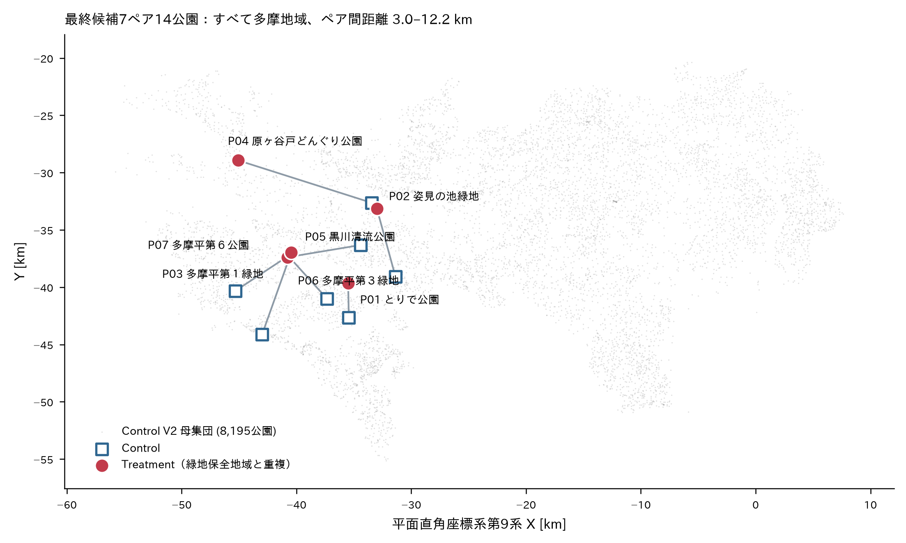

# 東京都の緑地保全地域と重複する都市公園の音環境比較

Comparing the acoustic environments of Tokyo urban parks that overlap ordinance-designated nature conservation areas (緑地保全地域) with matched non-designated parks.

卒業論文（青山学院大学 地球社会共生学部）の研究リポジトリ。GIS によるマッチドペア設計の構築過程と、現地録音に進むための資料一式を収録しています。

---

## Abstract

本研究は、東京における自然の保護と回復に関する条例に基づく緑地保全地域と重複する都市公園（Treatment）と、主要な自然保全指定を受けていない都市公園（Control）の音環境を比較する卒業研究である。同条例は緑地保全地域の指定要件を樹林地・水辺地等の自然性に置き、静穏性を直接の指定要件としていない。そこで本研究は、公園面積と樹冠被覆率が近い公園同士を対応づけ、標準化された同一録音システムで観測される相対的な音響レベルを比較する設計を構築した。樹冠被覆率は東京都デジタルツイン実現プロジェクトの3次元点群データから算出し、算出パイプライン・マッチング結果・検証記録・判断の撤回記録を本リポジトリに収録している。現時点では GIS によるマッチドペア設計までが完了しており、音環境の測定は未着手で、公園ペアは PROVISIONAL（暫定）である。本研究は保全指定と観測される音環境の関連を記述するものであり、因果は主張しない。

---

## Introduction

人為騒音と野生生物の応答の関連は、分類群を横断するメタ分析および総説で整理されている（Kunc & Schmidt 2019; Shannon et al. 2016）。ただし分類群によって聴覚能力が異なり、音源・曝露レベル・観察される応答も多様であるため、単一の指標で代理させることはできない（Shannon et al. 2016）。本研究の対象地域と重なる東京西部の孤立緑地では、音圧レベルおよび道路交通騒音と、鳴く昆虫の出現との負の相関が報告されている（Mori & Osawa 2025）。緑地の音環境は、こうした文脈において記述する意味を持ちうる。

一方で、法的な保護区であっても人為騒音が広範に存在することが報告されており（Buxton et al. 2017）、保護ステータスと音圧レベルの関連は米国東部を対象に郡スケールで検討されている（Rice et al. 2020）。制度的区分を音環境の説明変数として扱う先例もある（Herrera-Montes 2018）。すなわち「保全指定を受けた場所は静穏である」という前提は、経験的に自明ではない。

制度の側を一次資料で確認すると、東京における自然の保護と回復に関する条例（平成12年12月22日 条例第216号）第17条第1項第5号は、緑地保全地域の指定要件を「樹林地、水辺地等が単独で、又は一体となって自然を形成している市街地の近郊の地域」の良好な自然の保護に置いており、騒音・静穏性・音環境に関する語を含まない。同条例第18条第2項が定める保全計画の法定記載事項には植生管理に関する事項が含まれる一方、音環境・騒音・静穏性は含まれない。対比として、都市緑地法第12条に基づく特別緑地保全地区の指定要件には「公害又は災害の防止等のため必要な遮断地帯、緩衝地帯」が明記されている。ここで確認したのは指定要件と保全計画の法定記載事項に静穏性が現れないことであり、各地域の保全計画本文は未確認であるため、音環境の管理が行われていないことを意味しない（詳細は [`docs/08_literature_review_report.md`](docs/08_literature_review_report.md) §1 を参照）。

したがって、緑地保全地域と重複する都市公園が、内部自然環境が類似する非指定公園と比べて実際にどのような音環境にあるかは、経験的に未検証の問いである。保護指定と音環境の関係は郡スケールでは検討されているが（Rice et al. 2020）、都市公園を単位とし、内部の自然環境条件を統制したうえで指定の有無を比較した研究は、本研究が検索した範囲では確認できなかった。検索範囲には限界があり（OpenAlex・J-STAGE/CiNii の網羅検索は未実施）、その内容は [`docs/08_literature_review_report.md`](docs/08_literature_review_report.md) §0 に記録している。

本研究はこの問いに対し、相対音響レベルという物理指標で記述的な比較を行う。生物の応答は測定せず、全体音響レベルを生物応答の代理指標としては用いない。文献の領域別整理と章別の引用マップは [`docs/09_literature_review_for_thesis.md`](docs/09_literature_review_for_thesis.md) にある。

---

## Research Question

> **Main RQ**: 内部自然環境特性が類似する都市公園を比較したとき、自然保全指定のある公園とない公園では、標準化された録音条件下で観測される音環境に体系的な差があるか。

> **Operational RQ**: 自然保全指定のある都市公園では、matched Control 公園と比較して、標準化された同一録音システムで観測される相対的な音響レベルが異なるか。

- **Treatment**: 東京における自然の保護と回復に関する条例（平成12年12月22日 条例第216号）第17条第1項第5号に基づく緑地保全地域と重複する都市公園
- **Control**: 主要な自然保全指定を受けていない都市公園
- **マッチング変数**: 公園面積・樹冠被覆率（Forest%）。低層植生率・水域率は補助変数
- **Primary Outcome**: ペア内の相対音響レベル差（絶対 dBA ではない）
- **録音機材**: DJI Mic 3（校正済み騒音計ではないことを研究上の限界として明示）

---

## Methods

### データの出所

#### 一次データ（本リポジトリには含みません）

| データ | 提供元 | 用途 |
|---|---|---|
| 緑のオープンデータ（GISデータ） | 東京都都市整備局（データセットID `t000008d2000000024`、2026-02-02公開、14レイヤ） | 都市公園ポリゴン、監査用レイヤ |
| 東京都保全地域 | 東京都環境局 | 緑地保全地域ポリゴン（種別「緑地保全地域」46ポリゴン／名称ユニーク38） |
| 東京都デジタルツイン実現プロジェクト 3次元点群データ（多摩地域） | 東京都（CKAN `tokyopc-tama-2023`、計測 2022年7月〜2023年1月、16点/m²以上、JGD2011 平面直角座標系第9系） | 樹冠被覆率の算出（**CC-BY**） |
| 土地利用現況調査GISデータ（令和4年 多摩・島しょ） | 東京都（データセットID `t000008d2000000019`） | 水域（コード700）、建物現況 |

**ライセンス表記は各データセットの配布条件を必ず原典で確認してください。** 本リポジトリで確認できているのは 3次元点群データの CC-BY のみで、他のデータセットの条件は未確認です。

一次データのファイル識別（SHA256）は [`data/qc/source_manifest_sha256_20261011.csv`](data/qc/source_manifest_sha256_20261011.csv) と [`data/qc/source_manifest_las_20261011.csv`](data/qc/source_manifest_las_20261011.csv) に記録しています。

### 再現手順

#### 環境

```bash
conda create -n geo python=3.12 geopandas shapely pyogrio rasterio pyproj fiona \
    matplotlib pandas numpy scipy -c conda-forge
conda activate geo
pip install laspy[lazrs] mapbox-vector-tile
```

#### 土地被覆の算出

```bash
# parkmap_<set>.json（公園→図郭の対応）と tiles_needed.json を用意したうえで
python src/run_landcover.py treatment     # Treatment 12公園 / 21図郭 / 約3.6 GB / 約7分
python src/run_landcover.py control10     # Control 114公園 / 224図郭 / 約37 GB / 約58分
```

`src/tile_stream_landcover.py` は図郭を1枚ずつ取得・処理・即削除するため、ピーク時のディスク使用量は約500 MB に収まります。

**主要パラメータ**（`src/landcover_pipeline.py`）

| 定数 | 値 | 意味 |
|---|---|---|
| `CRS` | EPSG:6677 | JGD2011 平面直角座標系第9系 |
| `RES` | 0.25 m | 解析グリッド（DEMホールドアウト検証で決定） |
| `H_TREE` | 3.0 m | 樹冠とみなす CHM 閾値 |
| `BUFFER` | 5.0 m | 公園ポリゴン周囲の点取得バッファ |
| `MIN_COVERAGE` | 0.95 → **0.93** | 使用可能とみなす被覆率（0.93 を提案中） |
| `PEN_MODE` | `"pulse"` | 多重反射率をパルス基準で算出 |

#### マッチング

```bash
python src/matching_feasibility.py
```

シナリオは3本（`S1` 面積＋樹冠＋低層植生＋水域、`S2` 面積＋樹冠＋水域、`S3` 面積＋樹冠）。caliper は面積比 0.667–1.5 かつ |Δ樹冠| ≤15 pt（厳格版は 0.80–1.25 / ≤10 pt）。

### リポジトリ構成

```
.
├── README.md                     このファイル
├── DATA_DICTIONARY.md            全CSVの列定義
├── docs/                         方法論ドキュメント（番号順に読める）
│   ├── 00_research_note_FIXED_20260930.md       研究ノート（FIXED・基準資料）
│   ├── 01_pipeline_verification_report.md       既存GISパイプラインの検証
│   ├── 02_landcover_dataset_decision_memo.md    土地被覆データセットの比較
│   ├── 03_landcover_source_comparison.md        「既存データを切り抜く」vs「LiDARから分類」
│   ├── 04_landcover_FIXED_decision.md           土地被覆の算出方法の決定
│   ├── 05_matching_feasibility_report.md        マッチング成立性
│   ├── 06_final_methodology_review.md           最終方法論査読
│   ├── 07_research_design_comparison.md         デザインA〜Dの10軸比較とDAG
│   ├── 08_literature_review_report.md           文献レビュー本体
│   ├── 09_literature_review_for_thesis.md       領域別整理と章別引用マップ
│   ├── 10_supervisor_decision_brief.md          指導教員相談資料
│   ├── 11_supervisor_consultation_summary.md    相談用1ページ要約
│   ├── reviews/                                 査読記録（指摘と採否）
│   └── reference/                               先行する再現性メモ
├── data/
│   ├── final/        暫定候補7ペア14公園（CSV + GeoPackage）
│   ├── matching/     マッチング結果・候補ランキング・感度分析
│   ├── landcover/    公園別の樹冠率・低層植生率・水域率、データ可用性監査
│   ├── qc/           検証結果・DEMホールドアウト・取得元ハッシュ
│   ├── literature/   文献証拠表（36件・18列）
│   └── gis/          1/500図郭グリッド、現地調査用レイヤ
├── src/              土地被覆算出パイプラインとマッチングのスクリプト
├── figures/          図
└── fieldwork/        現地踏査チェックリスト
```

### 意図的に含めていないもの

- `qgis_tokyo_acoustic_research.zip`（34 MB）— 一次データの作業コピー。Git には不適で、上記の出所から再取得できます
- LAS ファイル（1図郭あたり約170 MB、Control 処理で延べ約37 GB）— 同上
- 研究者個人のプロファイル、進学計画等の文書

---

## Results

### 主要な結果

#### 母集団と候補

| 項目 | 件数 |
|---|---:|
| 東京都の都市公園 | 8,770（都立83・区市町村立8,685・国営2） |
| Treatment 候補（Protection Ratio > 0） | 30（**全件が多摩地域。区部はゼロ**） |
| Control V2 | 8,195（うち多摩地域 3,767） |
| Protection Ratio ≥10% の Treatment | 12 |
| 土地被覆を算出できた Treatment | 11 |
| 土地被覆を算出した Control | 114（うち使用可能 95） |

#### 暫定候補：7ペア・14公園

docs/10_supervisor_decision_brief.md の暫定8ペアのうち、指定区域との重複面積が小さい P08（矢川緑地 × 北田南公園、重複 96.7 m²）を除いた7ペアである。この除外は指導教員への確認事項である（docs/10 の Q1）。

[`data/final/final_park_list.csv`](data/final/final_park_list.csv) — 現地調査に進む公園の一覧（1公園1行）
[`data/final/final_pair_summary.csv`](data/final/final_pair_summary.csv) — ペアごとの一致度

| pair | Treatment（自治体） | Control（自治体） | 面積比 | Δ樹冠 pt | PR % | 指定重複 m² |
|---|---|---|---:|---:|---:|---:|
| P01 | とりで公園（多摩市） | 貝取第五公園（多摩市） | 1.013 | −0.20 | 77.15 | 4,879.4 |
| P02 | 姿見の池緑地（国分寺市） | 大丸公園（稲城市） | 1.084 | −1.05 | 40.06 | 5,215.3 |
| P03 | 多摩平第１緑地（日野市） | 西片倉只沼の尾根緑地（八王子市） | 1.012 | +1.40 | 67.20 | 7,324.9 |
| P04 | 原ヶ谷戸どんぐり公園（福生市） | 西恋ヶ窪緑地（国分寺市） | 0.984 | −2.27 | 49.68 | 7,026.1 |
| P05 | 黒川清流公園（日野市） | 小山小谷田端緑地（町田市） | 1.015 | −5.10 | 99.38 | 9,116.6 |
| P06 | 多摩平第３緑地（日野市） | 府中崖線西府町緑地（府中市） | 1.321 | −2.91 | 92.21 | 4,455.4 |
| P07 | 多摩平第６公園（日野市） | 三本松緑地（八王子市） | 1.283 | +4.80 | 99.52 | 4,873.1 |

|Δ樹冠| は最大 5.10 pt・中央値 2.27 pt。全14公園が多摩地域、延べ8市（Treatment 4市・Control 6市）。ペア間の直線距離は 3.0–12.2 km。



### ⚠️ 現在のステータス

| 段階 | 状態 |
|---|---|
| 1. データ取得・前処理 | **完了** |
| 2. ソフトウェア処理（土地被覆算出） | **完了** |
| 3. 分類精度の検証 | **未実施** |
| 4. マッチング妥当性の検証 | **部分完了** |
| 5. 音環境の測定・分析 | **未着手** |

**本リポジトリの公園ペアは PROVISIONAL（暫定）です。** 指導教員の承認を経ていないため、最終確定ではありません。未確定事項は [`docs/10_supervisor_decision_brief.md`](docs/10_supervisor_decision_brief.md) の §6 を参照してください。

**因果効果は主張しません。** 本研究は保全指定と観測音環境の「関連」を記述するものです。

---

## Discussion

### 既知の制約（重要）

1. **Treatment 群はクラスタ構造を持ちます。** 7件のうち **4件が単一の東豊田緑地保全地域に由来し、すべて日野市内**です（多摩平第１緑地・黒川清流公園・多摩平第３緑地・多摩平第６公園）。残りは国分寺姿見の池・多摩東寺方・立川崖線の各保全地域に1件ずつ。ペアを独立標本として扱うと保全地域レベル・自治体レベルの効果を過小評価します。
2. **水域の有無が2ペアで食い違います**（P05 黒川清流公園 12.93%、P06 府中崖線西府町緑地 2.68%）。水音は遮蔽物ではなく音源として働くため、感度分析で扱う必要があります。
3. **周辺環境（交通量・道路・市街化度）は統制していません。** 緑地保全地域は崖線・丘陵に偏在するため、Treatment と Control で立地条件が系統的に異なる可能性があります。
4. **P06・P07 は面積比が 1.3 前後**で、厳格 caliper（0.80–1.25）を外れます。
5. **全14公園の立入可否・開園時間は未確認**です。

### 方法論上の既知の判断と撤回

本研究では、誤った判断を発見した場合に撤回記録を残しています。主なものは以下です（詳細は `docs/reviews/`）。

| 撤回・訂正した主張 | 現在の扱い |
|---|---|
| LAS ヘッダの `creation_date` を計測日とみなす | **却下**。`gps_time_type = 0` で週番号が欠落しており絶対日付は復元不能。隣接図郭で作成日が5か月離れていても gps_time 分布はほぼ同一 |
| 解像度 0.5 m が 0.25 m より有利 | **撤回**。DEM ホールドアウト検証で 0.25 m が全条件で最小誤差（無作為セル MAE 0.027 m、樹冠下ブロック RMSE 0.178 m） |
| 多重反射率が樹冠を決定的に分離する | **撤回**。CHM で定義した群を CHM で評価する循環論法だった |
| 土地利用現況調査が公園内部を単一区分で表す | **訂正**。実際には細分されているが、森林%=0 となる公園が 86.2% あり樹冠の代替にはならない |
| 「図郭なし公園 30件」 | **訂正**。1/500図郭を算術的に再構成した結果、実際は 0件 |
| 樹冠被覆率を揃えれば物理的遮蔽条件も揃う | **却下**。植生の減衰は帯幅・見通し・幹径・樹間距離に依存（Fang & Ling 2003, 2005; Van Renterghem et al. 2012） |

---

## Schedule

1. 指導教員に [`docs/10_supervisor_decision_brief.md`](docs/10_supervisor_decision_brief.md) の3問を確認（PR閾値・絶対面積下限・水域の扱い）
2. 14公園の立入可否・開園時間を確認
3. [`fieldwork/field_reconnaissance_checklist.md`](fieldwork/field_reconnaissance_checklist.md) に従い Mapillary・航空写真で事前確認
4. DJI Mic 3 の録音再現性パイロットを1公園で実施
5. 録音地点の確定（代表点を基礎とし、Treatment は指定区域内、ペア内で地表被覆タイプを統一）

---

## References

文献証拠表（36件・確認水準つき）は [`data/literature/literature_evidence_table.csv`](data/literature/literature_evidence_table.csv)、章別の引用マップは [`docs/09_literature_review_for_thesis.md`](docs/09_literature_review_for_thesis.md) にあります。

- Buxton, R. T. et al. (2017) Noise pollution is pervasive in U.S. protected areas. *Science* 356(6337), 531–533. https://doi.org/10.1126/science.aah4783
- Rice, W. L. et al. (2020) Protected areas and noise abatement: A spatial approach. *Landscape and Urban Planning* 194, 103701. https://doi.org/10.1016/j.landurbplan.2019.103701
- Mori, H. & Osawa, T. (2025) Effects of complex soundscapes on the occurrence of *Anaxipha pallidula* in isolated green spaces. *Wildlife Biology*. https://doi.org/10.1002/wlb3.01515
- Kunc, H. P. & Schmidt, R. (2019) The effects of anthropogenic noise on animals: a meta-analysis. *Biology Letters* 15(11), 20190649. https://doi.org/10.1098/rsbl.2019.0649
- Shannon, G. et al. (2016) A synthesis of two decades of research documenting the effects of noise on wildlife. *Biological Reviews* 91(4), 982–1005. https://doi.org/10.1111/brv.12207
- Schisterman, E. F., Cole, S. R. & Platt, R. W. (2009) Overadjustment bias and unnecessary adjustment in epidemiologic studies. *Epidemiology* 20(4), 488–495. https://doi.org/10.1097/ede.0b013e3181a819a1
- Joppa, L. N. & Pfaff, A. (2009) High and far: Biases in the location of protected areas. *PLoS ONE* 4(12), e8273. https://doi.org/10.1371/journal.pone.0008273
- Van Renterghem, T., Botteldooren, D. & Verheyen, K. (2012) Road traffic noise shielding by vegetation belts of limited depth. *Journal of Sound and Vibration* 331(10), 2404–2425. https://doi.org/10.1016/j.jsv.2012.01.006
- 永幡幸司 (2019) 音環境の調査法 —ISO 12913シリーズに基づくサウンドスケープの調査法—. 日本音響学会誌 75(8), 473–480.

---

## License

本研究の本文・成果物は、古橋研究室のルールに従い CC BY 4.0 で公開する。

ただし一次データ（東京都の各データセット）はそれぞれの配布条件に従い、本リポジトリには含めない。派生データ（公園ポリゴン由来の座標等）は一次データの出典表示を継承する。

© Furuhashi Laboratory / Rito Yamasaki, CC BY 4.0

---

## 質疑応答

質問はこのリポジトリの Issue で受け付けます → [Issues](https://github.com/furuhashilab/2026gsc_RitoYamasaki/issues)
