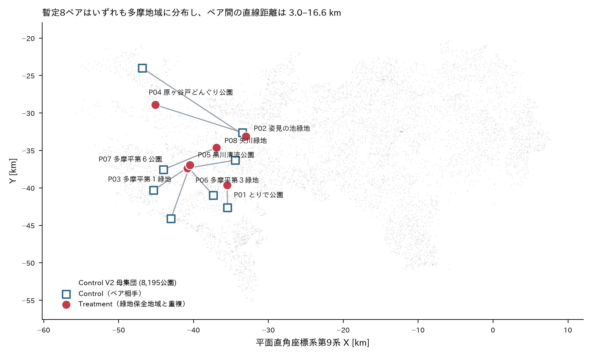

# 指導教員相談資料 — 現地録音開始前の確認事項

2026-10-20 / 卒業論文：東京都「緑地保全地域」と重複する都市公園の音環境比較

---

## 1. 研究目的

**Main RQ**: 内部自然環境特性が類似する都市公園を比較したとき、自然保全指定のある公園とない公園では、標準化された録音条件下で観測される音環境に体系的な差があるか。

**Operational RQ**: 自然保全指定のある都市公園では、matched Control 公園と比較して、標準化された同一録音システムで観測される相対的な音響レベルが異なるか。

**関連の検証であり、因果効果は主張しません。** 生物への影響は測定せず、全体音響レベルを生物影響の代理指標としません。

---

## 2. 現在の方法

- **母集団**: 東京都の都市公園 8,770件（都立83・区市町村立8,685・国営2）
- **Treatment**: 東京都条例（平成12年条例第216号）第17条第1項第5号の緑地保全地域と重複する都市公園。重複割合を Protection Ratio (PR) で管理
- **Control**: 主要な自然保全指定を受けていない都市公園 8,195件（うち多摩地域 3,767件）
- **マッチング**: 公園面積と樹冠被覆率（Forest%）で matched-pair を構成。低層植生率・水域率は補助変数
- **土地被覆の算出**: 東京都デジタルツイン3次元点群（LiDAR、16点/m²以上、2022年7月〜2023年1月計測）から0.25 m格子で樹冠被覆率を算出（CHM ≥3 m、建物フットプリント除外）
- **現地測定**: DJI Mic 3 による標準化録音。校正済み騒音計ではないこと、主解析で音源分類を行わないことは研究上の限界として受容済み
- **Primary Outcome**: ペア内の相対音響レベル差

---

## 3. 暫定ペア数

| PR閾値 | Treatment候補 | 土地被覆算出可 | 面積＋樹冠で成立 | 厳格条件で成立 |
|---|---:|---:|---:|---:|
| PR ≥10% | 12 | 11 | **8** | 6 |
| PR ≥25% | 11 | 10 | **8** | 6 |
| PR ≥50% | 7 | 6 | **5** | 3 |

**暫定8ペア（PR ≥10%・面積比0.667–1.5・樹冠率差15pt以内）**

| ペア | Treatment（自治体） | PR | Control（自治体） | 面積比 | Δ樹冠 | ペア間距離 |
|---|---|---:|---|---:|---:|---:|
| P01 | とりで公園（多摩市） | 77.2 | 貝取第五公園（多摩市） | 1.013 | −0.20 | 3.0 km |
| P02 | 姿見の池緑地（国分寺市） | 40.1 | 平松緑地（青梅市） | 1.007 | +0.56 | 16.6 km |
| P03 | 多摩平第１緑地（日野市） | 67.2 | 西片倉只沼の尾根緑地（八王子市） | 1.012 | +1.40 | 5.6 km |
| P04 | 原ヶ谷戸どんぐり公園（福生市） | 49.7 | 西恋ヶ窪緑地（国分寺市） | 0.984 | −2.27 | 12.2 km |
| P05 | 黒川清流公園（日野市） | 99.4 | 小山小谷田端緑地（町田市） | 1.015 | −5.10 | 7.6 km |
| P06 | 多摩平第３緑地（日野市） | 92.2 | 府中崖線西府町緑地（府中市） | 1.321 | −2.91 | 6.4 km |
| P07 | 多摩平第６公園（日野市） | 99.5 | 三本松緑地（八王子市） | 1.283 | +4.80 | 5.1 km |
| P08 | 矢川緑地（立川市） | 35.5 | 北田南公園（八王子市） | 1.136 | −9.84 | 7.7 km |

**Treatment 12件のうち成立しなかった4件の理由**: 城山手緑地（LiDAR被覆率 0.13 でデータ不足）、入間いちょう公園（最良Controlでも面積比1.83）、城山手しらかし公園・前沢第３緑地（同規模・高樹冠のControlが多摩に実在せず、樹冠率差 −18〜−19pt）。

全16公園の正式名称・park_key・住所・開園年月日・面積・土地被覆率・保全指定区域名・重複面積・代表点座標・地図/Mapillary URL は `park_pair_shortlist.csv`（8行59列）に、Treatment 12件の成立状況・代替候補・データ欠測・境界問題は `treatment_candidate_inventory.csv`（12行42列）にまとめてあります。

---

## 4. 主要文献による根拠

| 論点 | 文献 | 示していること |
|---|---|---|
| 保護区でも人為騒音は存在する | Buxton et al. 2017 *Science*; Rice et al. 2020 *Landscape Urban Plan.* | 米国保護区で人為騒音が広範に自然音を超過。保護ステータスが音圧レベルを予測（最厳格区分は音圧と**正**の関係） |
| 緑地の音環境は生態学的に意味を持ちうる | Kunc & Schmidt 2019 *Biol. Lett.*; Shannon et al. 2016 *Biol. Rev.*; **Mori & Osawa 2025 *Wildlife Biol.*** | メタ分析で多数の分類群が騒音に応答。**東京西部の孤立緑地で、音圧レベルと道路交通騒音が鳴く昆虫の出現と負に相関** |
| 内部自然条件でマッチングしてよい | Schisterman, Cole & Platt 2009 *Epidemiology* | 過剰調整バイアスは「曝露→アウトカムの因果パス上の中間変数の制御」と定義される。どの対比を推定するかに相対的 |
| ただし物理的遮蔽を揃えたことにはならない | Fang & Ling 2003, 2005; Van Renterghem et al. 2012 *J. Sound Vib.* | 植生の減衰は帯幅・見通し・幹径・樹間距離に依存。草地比で地表面効果の増加は約3 dBA |
| 立地の偏りが残る | Joppa & Pfaff 2009 *PLoS ONE*; Margaritis & Kang 2016 | 保護区は特定立地に偏る。周辺都市形態が交通騒音分布に関わる |
| 録音プロトコル | 永幡 2019 *日本音響学会誌*; Mitchell et al. 2020; Sakagami 2020 | ISO 12913 準拠の調査法。静穏地域でも音環境は大きく時間変動する |

**制度的事実（一次資料で確認）**: 条例第17条第1項第5号の指定要件に現れる自然環境要素は「樹林地」「水辺地」のみで、騒音・静穏性は含まれません。第18条第2項の保全計画の法定記載事項（自然の概況、保護と回復の方針、規制、**植生管理**、施設、活用等）にも音環境は含まれません。各保全地域の保全計画・指定時の植生は東京都環境局のサイトで公開されています。

> ただし、確認したのは「指定要件」と「保全計画の法定記載事項」に静穏性が現れないことです。**音環境の管理が全く行われていないとは断定できません**（各地域の保全計画本文は未確認）。

---

## 5. 周辺環境の記録方針

公園**内部**の自然環境は従来どおりGISでマッチングし、公園**周辺**の道路・鉄道・建物・地形・利用状況は、マッチング条件に追加せず、**Mapillary・航空写真・現地の徒歩観察で記録する**方針です（記録様式: `field_reconnaissance_checklist.md`）。

**この記録は記述的資料であり、交通量や騒音の影響を統計的に統制したものではありません。Mapillary画像から交通量や騒音レベルを推定することもしません。**

これに加えて、**最小限の客観的GIS指標2種類**の追加を提案します。いずれも既存データで算出でき、LiDARの再処理は不要です。

1. 公園境界から最寄り幹線道路までの最短距離（m）
2. 公園周囲100 mバッファ内の建物面積率（%）

これにより、周辺条件が大きく異なるペアを特定し、そのペアを除いた感度分析ができます。

---

## 6. 現在未確定の判断事項

| # | 事項 | 状態 |
|---|---|---|
| 1 | PR主分析閾値（≥10% / ≥25% / ≥50%） | **未確定** |
| 2 | 絶対面積・絶対重複面積の下限を設けるか | **未確定** |
| 3 | Water%（水域率）の最終的なマッチング条件 | **未確定** |
| 4 | 最終的な公園ペアの確定 | **未確定** |
| 5 | 録音地点（各公園内の具体的位置） | **未確定** |
| 6 | 周辺環境の調査範囲（外周＋おおむね100 m） | **未確定** |
| 7 | 追加GIS指標（上記2種類）を採用するか | **未確定** |
| 8 | 感度分析の構成 | **未確定** |
| 9 | 1地点あたりの録音時間・反復回数・相対レベルの算出方法 | **未確定** |
| 10 | 全16公園の立入可否・開園時間 | **未確認**（現地・自治体サイトで確認予定） |

**1〜4 と 8 は、録音結果を見る前に固定する必要があります。** 録音後に決めると、結果に合わせて条件を選んだことになり妥当性が失われます。

---

## 7. 先生に確認したいこと（3点）

### Q1. 主分析の対象を「PR ≥25% かつ 指定区域との重複面積 ≥2,000 m²」とし、7ペアで進めてよいでしょうか。

Protection Ratio は**割合**なので、絶対面積を保証しません。暫定8ペアのうち **P08（矢川緑地 273 m² – 北田南公園 310 m²）は、指定区域との重複面積がわずか 96.7 m²** です。26 m × 26 m の公園の内部に録音点を置くことは、境界から十数メートル以内での測定を意味し、「公園の音環境」ではなく「隣接道路の音環境」を測ることになります。

絶対面積の下限（公園 ≥2,000 m²、指定重複 ≥2,000 m²）を設けると **8ペア → 7ペア**になりますが、残る7ペア（P01〜P07）は公園面積 4,832 m² 以上・指定重複 4,455 m² 以上で揃い、全ペアで録音点を指定区域内に置けることが保証されます。**ペア数を1つ減らして質を確保する**という判断でよいか、ご意見を伺いたいです。

なお PR 閾値を ≥10% から ≥25% に上げても成立ペア数は 8 のまま変わりません（PR 20.13% の城山手しらかし公園は元々マッチング不成立のため）。

### Q2. 水域率（Water%）はマッチング変数から外し、水域の有無が食い違うペアを除いた感度分析として扱ってよいでしょうか。

**暫定8ペアのうち4ペアで水域の有無が食い違っています**（P02 姿見の池 4.3% 対 平松 0、P05 黒川 12.9% 対 小山小谷田端 0、P06 多摩平第３ 0 対 府中崖線西府町 2.7%、P08 矢川 55.0% 対 北田南 0）。

水域を持つ Treatment は 3件しかなく、土地被覆を算出できた Control 95件のうち水域1%以上は 4件のみです。水域を厳密一致条件にすると、面積・樹冠の一致を犠牲にしてペアを組むことになります。

一方、水音は遮蔽物ではなく**音源**として働くため（Rådsten-Ekman et al. 2013）、不一致を無視することもできません。そこで「主解析ではマッチング変数に含めず、水域不一致ペアを除いた感度分析を**事前に**設定しておく」という扱いを提案します。この方針でよいか、あるいは水域ありTreatmentのみ水域ありControlと組む制約を課すべきか、ご判断いただきたいです。

### Q3. 録音地点を「ポリゴン内代表点」＋「樹冠下に統一」というルールで決めてよいでしょうか。

重心を使うと問題が生じます。**Treatment 12件のうち4件（矢川緑地・多摩平第１緑地・黒川清流公園・城山手緑地）で、公園重心がポリゴンの外にあります**（崖線沿いの細長い形状のため）。そこで、ポリゴン内であることが保証される representative point を基礎とし、Treatment では指定区域との重複部分の内部にとる、というルールを提案します（全126公園分を算出済み）。

あわせて、**ペアの両公園で録音点の地表被覆タイプを揃える**（両方とも樹冠下、または両方とも非樹冠部）条件を設けたいと考えています。これは「Treatment を樹林内、Control を芝生広場で測る」ことを避けるためです。実際、P02（姿見の池緑地 – 平松緑地）は樹冠率の差が 0.56 pt と極めて良好な一方、**低層植生率は 11.8% 対 50.1%、その他被覆率は 41.2% 対 1.4%** と非樹冠部の構成が大きく異なります。

このルールで公平性が確保できるか、あるいは1公園2地点（代表点＋最も離れた立入可能点）にすべきかをご相談したいです。

---

## 8. 地図・QGISデータの利用方法

- **地図**: `park_pairs_map.png` — 暫定8ペアの位置関係。灰色の点が Control V2 母集団 8,195公園、赤丸が Treatment、白四角が Control、線がペア関係を示します。座標は平面直角座標系第9系（EPSG:6677）。
- **GeoPackage**: `park_pairs_fieldwork.gpkg`（EPSG:6677）。QGIS で直接開けます。3レイヤ構成です。

| レイヤ名 | 内容 |
|---|---|
| `pair_parks` | 16公園のポリゴン（属性に pair_id、pair_role、公園名、区市町村、位置、開園年月日、park_key、面積、ペア相手名） |
| `treatment_conservation_overlap` | Treatment 8公園と緑地保全地域の重複部分のポリゴン（属性に指定区域名、重複面積） |
| `representative_points` | 全16公園のポリゴン内代表点（録音点の出発点） |

既存の QGIS プロジェクト（`qgis_tokyo_acoustic_research`）に追加する場合は、`tokyo_treatment_control_audit_v2.gpkg` と同じ CRS なので、そのままドラッグ＆ドロップで重ねられます。`park_pair_shortlist.csv` は `T_park_key` / `C_park_key` で既存レイヤの `park_key` フィールドと結合できます。

---

## 9. 添付資料

- `final_methodology_review.md` — 最終方法論査読（4変数マッチングの評価、Mapillary調査の妥当性、録音地点選定ルール、省略可能な作業）
- `park_pair_shortlist.csv` — 暫定8ペア 16公園の詳細一覧
- `treatment_candidate_inventory.csv` — PR ≥10% Treatment 12件の成立状況・代替候補
- `field_reconnaissance_checklist.md` — Mapillary事前調査＋徒歩観察の記録様式（16公園分の事前情報付き）
- `literature_review_for_thesis.md` — 先行研究の領域別整理と章別引用マップ
- `park_pairs_map.png` / `park_pairs_fieldwork.gpkg` — 地図とQGISデータ
