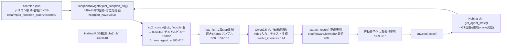

# FP-Nav（FloorPlan-VLN）卒論研究対象 適格性調査レポート

> 調査日: **2026-11-05** / 対象コミット: `eac1989137f46fce495276a6f85ce69a63e5e117`（GitHub `main`）
> 調査者: Claude Code（一次資料＋実コードを検証）。過去の伝聞はすべて未検証仮説として扱い、裏取りした。

---

## 0. 前提と調査方法

- **卒論の問い**: 「Physical AI が誤った地図情報を与えられたとき、判断はどう変化するか」。
- **実行環境（訂正後）**: 実際の研究・推論は研究室の **メモリ32GB以上のMac** で行う。
  本調査を実行した16GB Mac は調査専用であり、**その16GBという制約はFP-Nav不採用の理由にしない**。
  ただし研究室Macでの動作は本レポートでは **未検証（見込み）** として扱う。
- **方法**: リモートGitHubを浅くクローン（LFS除外・コードのみ28MB）し、実ファイル／関数／行番号を確認。
  論文・HFモデル・HFデータセットはWebで実在と内容を確認。
  **モデル重み・MP3Dシーン・学習データ等の大容量DLは未実施**（破壊的・大容量操作は事前確認が必要なため）。
- **事実と推測の区別**は §11 に明示。本文中 `file:line` はクローンしたコミットの該当箇所。

---

## 1. Executive Summary

**結論: FP-Nav は卒論の研究対象として「妥当（①○）」かつ「科学的に評価可能（②○）」。
技術的実現性（③△）と学術的新規性（④△）は条件付き。総じて「採用候補として有望、ただし要検証事項あり」。**

| 観点 | 判定 | 一言 |
|---|---|---|
| ① 研究対象としての妥当性 | **○** | 地図入力を条件に行動テキストを出す学習型VLM（Qwen2.5-VL-7B微調整）とコード・configで確認 |
| ② 科学的評価可能性 | **○** | 地図は入力画像の固定領域。RGB・指示を固定し地図だけ差替可。1ステップ判断をHabitat無しで単体実行でき、生出力を直接比較できる |
| ③ 技術的実現可能性（研究室32GB Mac・実機なし） | **△** | 非量子化が載る見込み。ただし flash-attn→sdpa 改変必須・MPS未検証・Habitatはmac非対応。1ステップ推論はHabitat不要。実動作は未検証 |
| ④ 学術的新規性 | **△** | 幾何ノイズ耐性は FP-Nav 本体・FloNa 等で既出。「地図×視覚の矛盾時にどちらを信じるか」判断レベル分析に余地。要追加サーベイ |

**重要な障害・留意（意思決定に直結）**
1. 公式コードは **CUDA前提**（`fp_nav_agent.py:39` に `attn_implementation="flash_attention_2"` ハードコード、評価はHabitat-sim/lab v0.1.7＝torch1.10+cu111）。Apple Silicon では **コード改変が必須**、Habitatフル評価は mac では事実上不可。
2. ただし **1ステップの地図条件付き判断の研究は Habitat 不要**で offline 化できる（`predict_inference` は frames＋instruction のみに依存, §4）。研究の核はこの経路で成立する。
3. 間取り図は **MP3D（実在建物スキャン）の領域注記から生成した意味的ポリゴン地図**。「実在建物由来」だが「公開された正確な建築図面」ではない（§5）。
4. 配布モデルは **微調整済み FP-Nav**（16.6GB, `qwen2_5_vl`）。素の Qwen2.5-VL-7B とは別物として扱うこと。

---

## 2. システム構成（地図がAIの判断へ到達するまで）

ライブ評価（`fp_nav_agent.py` の `evaluate_agent`）での実経路:

要点:
- モデル入力は「**エゴRGB（左）＋ 軌跡・方位を重ねた間取り図（右）**」を横連結した画像を時系列に積んだ **動画**（論文の "dual-view, spatio-temporally aligned video"）。
- 間取り図は毎ステップ **JSONからライブ描画**（動画への事前焼き込みではない＝差替え可能）。
- 地図上の自己位置／軌跡は **Habitat の ground-truth pose**（`:405`）由来＝**測位はオラクル**。地図は「レイアウト事前情報」であり測位源ではない。

---

## 3. コード解析結果（重要ファイル・関数・行番号）

| 項目 | 場所 | 事実 |
|---|---|---|
| エントリ | `run.py` | `make_dataset`→`evaluate_agent`。`--model-path` 等必須 |
| 起動 | `eval_fp_nav.sh:3,14` | `CHUNKS=8`・`CUDA_VISIBLE_DEVICES` で8GPU並列前提 |
| モデルロード | `fp_nav_agent.py:36-42` | `Qwen2_5_VLForConditionalGeneration`, `torch_dtype=bfloat16`, **`attn_implementation="flash_attention_2"`(CUDA専用・mac不可)**, `device_map="auto"`, `tokenizer.padding_side='left'` |
| 地図読込 | `fp_nav_agent.py:27,372-373` | `FLOORPLAN_PATH="data/mp3d_floorplan_graph"` から `<scene>/floorplan.json` を `json.load` |
| 地図→画像 | `floorplan_nav.py:508` | `floorplan["levels"][lvl]["regions"]` の各 `boundaries`(多角形)+`label`(部屋種) を 448x448 に描画 |
| 連結(入力化) | `fp_nav_agent.py:382-383,413-414` | `floorplan_nav_img[...,::-1]`(BGR→RGB) 後 `cv2.hconcat([obs['rgb'], floorplan_nav_img])` |
| 推論 | `fp_nav_agent.py:194-206` | video化→`model.generate(do_sample=False, use_cache=True, max_new_tokens=512)` → テキスト |
| プロンプト | `fp_nav_agent.py:180` | "...given a navigation video and your assigned task is: {instruction}. Decide your next action..."（逐語は `FP_NAV_INFERENCE_SPEC.md`） |
| 出力の正体 | `fp_nav_agent.py:208-231` | モデルは**自由文テキスト**。正規表現で `stop/forward/left/right`＋数値を抽出 |
| 後処理 | `fp_nav_agent.py:309-327` | 数値を離散化（前進 `int(num/25)`、旋回 `int(num/15)`、各最大3回）。抽出失敗時 `random.randint(1,3)`(:324) |
| 地図更新 | `fp_nav_agent.py:405-414` | 毎step GT pose で軌跡/方位更新→地図再描画→再連結 |
| 地図ノイズ(評価) | `fp_nav_agent.py:330-351` | `add_mask`(25%白塗), `add_mask_to_floorplan_nav`(**右半分 `frame[:,448:,:]` のみ**破損)。**定義済・評価ループ内未呼出** |
| 地図ノイズ(学習) | `qwen-vl-finetune/qwenvl/data/data_qwen.py:311-325` | `add_gaussian_noise`(σ=300) を右半分に。学習時拡張（:307 にコメントアウト呼出） |
| 幾何歪み群 | `floorplan_nav.py:530,562,605` | `use_poly_noise`(頂点ジッタ), `use_poly_drop`(部屋欠落), `use_scale_noise`(地図/軌跡スケール不一致) |
| 行動設定 | `VLN_CE/habitat_extensions/config/fp-nav-r2r.yaml` | `FORWARD_STEP_SIZE:0.25`(m), `TURN_ANGLE:15`(°), 行動=STOP/MOVE_FORWARD/TURN_LEFT/TURN_RIGHT, RGB 448x448 HFOV90 h1.5m, `SUCCESS_DISTANCE:3.0`, `MAX_EPISODE_STEPS:500` |
| 評価設定 | `VLN_CE/vlnce_baselines/config/fp-nav.yaml` | `SPLIT:val_unseen`, `EARLY_STOP_ROTATION:25`, `EARLY_STOP_STEPS:250` |

**モデル実体**（HF `keeehan/FloorPlan-VLN` config.json）: `model_type=qwen2_5_vl`, `architectures=[Qwen2_5_VLForConditionalGeneration]`, `torch_dtype=bfloat16`, `hidden_size=3584`（7B級）。重み総計 **16.6GB**（`fp-nav-vision-r2r-rxr-lr-4e-5-videoframe6/`）。

### VLMの判断 vs ロボット制御（A-2）
- 次行動を決めるのは **VLM 自身**（方向＋量を自由文で出力）。後段は**規則変換のみ**（正規表現＋量子化）で学習型の別プランナは無い。
- 生出力テキスト（`navigation`, `:302`）は取得可能。現状ログは metrics のみ（`:418-421`）だが、生出力記録は容易。
- → VLMの「判断」と Habitat の「行動実行」は明確に分離できる。

---

## 4. 地図入力の評価可能性（変更できる情報・固定できる条件・判断取得）

**モデルに渡る地図情報**: 部屋ごとの多角形境界 `boundaries` と部屋種ラベル `label`（`ROOM_LABELS` a〜z＝MP3D領域カテゴリ, `floorplan_nav.py:21-53`）を 448x448 に描いた画像＋軌跡＋方位矢印。座標の生数値ではなく**レンダリング画像**として渡る（画像化で絶対寸法等は失われる）。

**操作可能性（コード根拠）**
- 地図は入力画像の**固定領域（右半分 `frame[:,448:,:]`, `:347`）**。リポジトリ自身が同領域を上書き（ノイズ注入）＝**RGB・指示を固定し地図だけ差替可能**。
- `predict_inference(instruction, frames)`（`:194`）は **Habitat 非依存**。frames＋指示があれば1判断を単体実行できる → **1ステップ判断の単体評価が可能**。
- 元環境データ／評価GT（`val_*_gt.json.gz`）は独立保持。モデル出力テキストを直接比較できる。
- 地図が効いている傍証: 論文は floorplan 有無で **成功率+60%相対改善** と主張（アブレーションで地図が効く）。

**確信度を下げる注意点（confound）**
1. **測位はオラクル**（GT pose）。研究で操作できるのは地図の「内容(壁/部屋/ラベル)」であり「測位誤差」ではない。
2. **学習時に地図ガウスノイズ拡張**あり（`data_qwen.py:322`）＝モデルは地図破損に**設計上ある程度頑健化**。「誤地図で判断が変わるか」の解釈はこの頑健化と切り分ける必要がある。
3. 幾何歪みでは軌跡オーバレイが（歪んだ）領域にフィットして描かれるため、「別建物の地図を丸ごと差替え」する際は軌跡描画の整合に注意（手法設計上の論点）。

→ **方法論として「他要因を固定し地図だけ変える」統制が可能 ＝ ②は○**。ただし上記confoundは論文の頑健性主張と表裏で、研究の切り口設計が前提（§7）。

---

## 5. データの実在性と来歴（C）

- **元データ = Matterport3D（実在建物90棟の3Dスキャン）**。間取り図は MP3D の**領域アノテーションから生成**されたポリゴン地図（`ROOM_LABELS` が MP3D region カテゴリと一致、構築手順 `README.md:217` "construct mp3d floor plans"）。
- したがって **「実在建物由来」YES／「実際に公開された正確な建築図面」NO**。これは3Dスキャン注記から起こした*意味的間取り図*であり、建築確認図面ではない。← 依頼で曖昧化を禁じられた点を明示。
- **公開物（HF datasets `keeehan/FloorPlan-VLN`, 計604MB）**: `mp3d_floorplan/`(280ファイル, 間取りJSON), `FloorPlan-VLN-R2R/`・`FloorPlan-VLN-RxR/`, 微調整JSON(423MB+160MB), 評価用 `val_seen/unseen(.json.gz, _gt.json.gz)`。学習用動画は別repo（`keeehan/FloorPlan-VLN-R2R`/`-RxR` の分割tar）。
- **MP3Dシーン本体（.glb, 約15GB級）は非同梱**。公式MP3Dの利用規約同意＋ダウンロード（`download_mp.py`, python2.7）が必要＝**アクセスゲートあり・非商用学術限定**。
- **再現性**: MP3D入手＋構築コードで原理的に再生成可能だが、著者が「構築工程は非常に複雑で統合コード未整備のため簡単な説明に留める」と明記（`README.md:215`）＝**ターンキー再現は不可**。
- HF dataset viewer のスキーマ不一致エラーは**ビューア表示問題でファイル実体に影響なし**。

---

## 6. 研究室Mac（32GB+）での再現可能性（D：推論と評価環境を分離）

本調査機は Apple M3 / 16GB / 空き14GB だが、**本節は研究室の32GB+ Macを対象**に評価する（実動作は未検証）。

### D-1. モデル単体推論
| 問い | 現時点の見込み（未検証） | 根拠 |
|---|---|---|
| 非量子化で必要メモリ | 16.6GB(重み)＋活性/KV。**32GB統合メモリなら載る見込み** | HF重み16.6GB, hidden3584(7B) |
| flash-attn依存 | **CUDA専用をハードコード**。macでは `sdpa`（または`eager`）へ**改変必須** | `fp_nav_agent.py:39` |
| MPS動作 | transformers の Qwen2.5-VL は一般にMPS動作例あり。**本repoコードはMPS未対応・改変必須・未検証** | — |
| device_map="auto" | macでは `"mps"`/`"cpu"` 明示へ変更が必要 | `:41` |
| CPU実行 | 7Bのvideo推論は非現実的に遅い想定（未測定） | 一般論 |
| 量子化 | bitsandbytesはCUDA専用。MLX等への移植は**別モデル化**し比較可能性を損なうため**最初から前提にしない** | — |

### D-2. シミュレーション・評価環境
- Habitat-sim/lab **v0.1.7**（2019年系, `torch==1.10.0+cu111`, MP3D DLは python2.7）＝**実質Linux+CUDA専用。Apple Silicon非対応**（`README.md:158-186`）。
- フル評価（episode成功率の再現）は Mac では事実上不可。
- **ただし 1ステップ判断の評価は Habitat 不要**。`predict_inference` は frames＋instruction のみ依存。学習データは (RGB|地図) 連結済み `.mp4` として配布（`README.md:82-89`）、`decord`/`torchcodec` は**学習データ読込専用**で、推論経路は `opencv`/`imageio` で代替しHabitatもdecordも回避できる。

### D-3. 「公式対応 / コード上可能 / 実動作確認済み」の区別
- **実動作確認済み（この調査で実行）**: repo存在・構造（28MBクローン）、各file:line、config.json・HF重み16.6GB・データセット604MBの実在、本調査機スペック。
- **コード上可能（未実行）**: 1ステップoffline判断、地図右半分差替え、flash-attn→sdpa改変。
- **公式に非対応／未確認**: Apple Silicon でのQwen2.5-VL推論、MPS経路、Habitatのmac動作。
- **未実施（意図的）**: モデル重み/シーン/学習データのDL、ライブラリ大量インストール、実推論。→ **「動作確認済み」とは記載しない**。

---

## 7. 先行研究との比較（E：新規性）

**FP-Nav自身が既に実施した地図の誤り実験（コード根拠）**
- 頂点ジッタ `use_poly_noise`、部屋欠落 `use_poly_drop`、スケール不一致 `use_scale_noise`（`floorplan_nav.py:562-603`）、ガウスノイズ学習拡張（`data_qwen.py:322`）、パッチマスク（`fp_nav_agent.py:330`）。
- アブストで "comprehensive noise modeling ... robustness ... to actuation drift and geometric map distortions" と**「頑健である」方向で**報告。主に測るのは **episode成功率の低下幅**。

**関連先行研究（部分サーベイ・出典§10）**
- **FloNa**（AAAI 2025 / arXiv:2412.18335）: 間取り図ガイド視覚ナビで**スケール誤差・幾何摂動に対し成功率低下は軽微**、絶対座標でなく不変レイアウトを使う、と報告。「地図不正確さへの頑健性」は既に主題化。
- **NavTrust**（arXiv:2603.19229）: embodied navigation の信頼性ベンチマーク。
- "Explore, Map, Remember, Decide: Are Embodied VLMs Ready for Safety-Critical Scenarios?"（arXiv:2608.08077）, AgentVLN 等、VLMナビの頑健性/安全性は活発。

**重複と残余（研究余地）**
- 既に被る: 「地図に幾何ノイズを足して成功率低下を測る」系。単なる追試は新規性が薄い。
- **残っていそうな隙間（要差別化・要追加サーベイ）**:
  1. 幾何ノイズでなく **意味的/構造的に"誤った"地図**（別建物の地図、部屋ラベル入替、存在しない部屋/出口の付加）。
  2. **成功率でなく判断レベル**: 地図と視覚が**矛盾**するとき VLM は**地図を信じるか目(カメラ)を信じるか**（over-reliance / cue conflict）。検索でも "map-to-visual alignment under-examined", "over-reliance on single cue" と指摘あり。
  3. 1ステップ出力の**発散/失敗モードの類型化**（従来は集約指標中心）。
- **留保**: 本調査のサーベイは **Web検索2本のみ**で網羅的でない。FloNa/NavTrust/本論文の該当節を精読し、隙間が本当に未検証かを確認するまで新規性は確定できない（④＝△）。

---

## 8. 総合判定（4観点・根拠つき）

**① 研究対象としての妥当性 — ○**
地図(floorplan.json→画像)を入力条件に含め、行動を自由文で出力する学習型VLM（Qwen2.5-VL-7B微調整）であることを config.json とコード経路（`fp_nav_agent.py:372-383→194→208`）で確認。決定はVLM、後段は規則変換のみ。
留保: 出力は粗い（方向+量の量子化）、測位はオラクル。地図は「測位源」でなく「レイアウト事前情報」。

**② 科学的評価可能性 — ○**
地図は入力画像の固定領域(右半分)で、RGB・指示を固定し地図だけ差替可能（repo自身が同領域を上書き）。`predict_inference` がHabitat非依存で1判断を単体実行でき、生出力テキストを直接比較できる。GTは独立保持。
留保(重要): 学習時地図ノイズ拡張による**設計上の頑健化**＋測位オラクルのconfound。「誤地図で判断が変わる」の解釈はこれを踏まえた切り口が前提。

**③ 技術的実現可能性（研究室32GB Mac・実機なし）— △**
32GB Apple Silicon なら非量子化が載る見込みだが、flash-attn→sdpa 改変必須・MPS経路未検証・Habitatフル評価はmac不可。**ただし研究の核である1ステップ判断はHabitat不要で成立**。実動作は未検証のため○にはしない。
（本調査機の16GB/空き14GBは調査専用で、採否理由にはしない。）

**④ 学術的新規性 — △**
幾何ノイズ耐性はFP-Nav本体・FloNa等で既出。意味的誤地図／地図×視覚の矛盾時の判断／判断レベル失敗モード分析に余地がありそうだが、**先行研究調査が未完**（検索2本）で確定不可。

---

## 9. 未確認事項と次に必要な検証（優先順）

1. **（最優先）研究室Macでの最小1ステップ推論の実動作確認**: 16.6GB重みを研究室Macで取得→`sdpa`改変→`run_single_step.py`（同梱）で生出力が得られるか。成功＝「このモデルが地図付き入力で行動テキストを返す」ことの実証。
2. **モデルが地図を本当に使っているかの独立確認**: 同一観測で 地図を全マスク vs 正規 の出力差（論文の+60%主張を手元の1ステップで再確認）。
3. **著者評価の部分再現**: 可能なら研究室/学内のLinux+NVIDIA機で Habitat フル評価を小規模splitで走らせ、論文の成功率レンジに入るか。
4. **先行研究の精読サーベイ**: FloNa・NavTrust・本論文の該当節＋"cue conflict/over-reliance in VLN" を精査し §7 の隙間が未検証かを確定。
5. **地図差替えの技術的詰め**: 「別建物の地図」投入時の軌跡オーバレイ整合（`transforms`/`transform_traj`）。**著者推論を再現できてから**着手。
6. **ライセンス確認**: コード Apache-2.0。MP3D利用規約（非商用学術・要同意）と生成物再配布可否を卒論利用前に確認。

---

## 10. 参考文献・参照コード

**一次資料（確認日 2026-11-05）**
- 論文: FloorPlan-VLN, arXiv **2603.17437** (v1, 2026-03-18), K. Chen, Y. Huang, D. An, J. He, Y. Su, J. Liu, N. Liu, L. Wang. HTML: https://arxiv.org/html/2603.17437v1
- GitHub: https://github.com/Chenkehan21/FloorPlan-VLN （commit `eac1989137f46fce495276a6f85ce69a63e5e117`, main, License **Apache-2.0**）
- モデル: https://huggingface.co/keeehan/FloorPlan-VLN （`fp-nav-vision-r2r-rxr-lr-4e-5-videoframe6/`, 計 **16.6GB**, `qwen2_5_vl`/bf16/hidden3584）
- データセット: https://huggingface.co/datasets/keeehan/FloorPlan-VLN （計604MB; `mp3d_floorplan/`280ファイル, 微調整JSON 423MB+160MB, R2R/RxR val splits）
- 学習用動画tar: `keeehan/FloorPlan-VLN-R2R`, `keeehan/FloorPlan-VLN-RxR`（HF, 分割tar）
- Matterport3D: https://niessner.github.io/Matterport/ （要規約同意・非商用学術）

**参照コード（ファイル:行）**
- `fp_nav_agent.py:36-42, 71-131, 133-192, 180, 194-206, 208-231, 300-327, 330-351, 354-422`
- `floorplan_nav.py:21-53, 508-528, 530-603`
- `qwen-vl-finetune/qwenvl/data/data_qwen.py:286-345`
- `run.py`, `eval_fp_nav.sh:3,14`, `VLN_CE/vlnce_baselines/config/fp-nav.yaml`, `VLN_CE/habitat_extensions/config/fp-nav-r2r.yaml`, `README.md:45-226`

**先行研究（部分サーベイ・要精読）**
- FloNa: Floor Plan Guided Embodied Visual Navigation, AAAI 2025, arXiv:2412.18335
- NavTrust: Benchmarking Trustworthiness for Embodied Navigation, arXiv:2603.19229
- Explore, Map, Remember, Decide: Are Embodied VLMs Ready for Safety-Critical Scenarios?, arXiv:2608.08077

---

## 11. 推測と未確認の区別（まとめ）

- **実証済み事実**: §3の全コード経路、モデル実体16.6GB/`qwen2_5_vl`、データ来歴（MP3D由来の意味的間取り図）、flash-attn/Habitatのmac非対応、地図ノイズ機構の存在、行動設定(0.25m/15°)。
- **コード上可能そう（未実行）**: 1ステップoffline判断、地図右半分差替え、sdpa改変。
- **未確認／要検証**: 研究室Macでの実動作、MPS・dtype変更の数値影響、新規性の確定（要追加サーベイ）、別建物地図差替えの軌跡整合。
- **やっていないこと**: 実機ロボットの安全性検証（本研究はシミュレーション/offlineに限定）、大容量DL、実推論。
